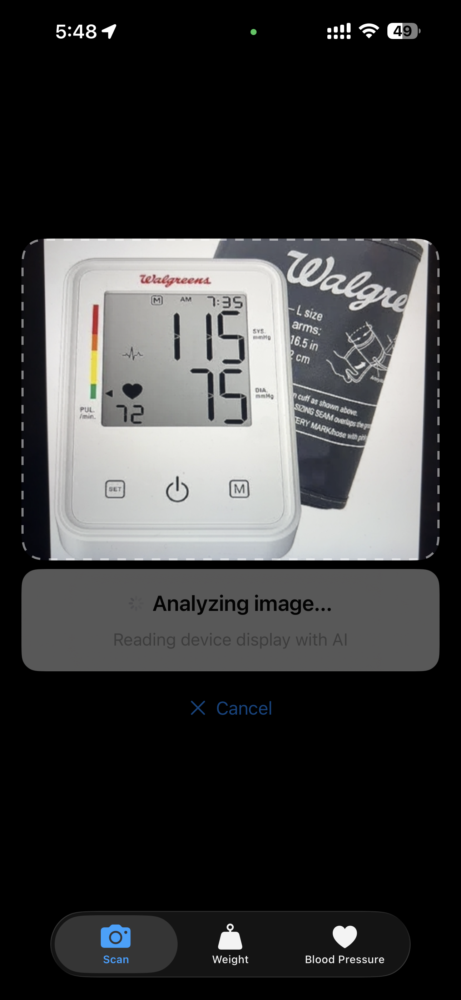
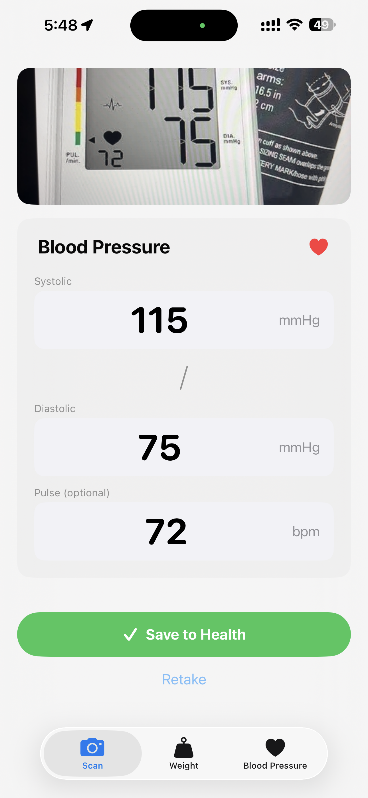
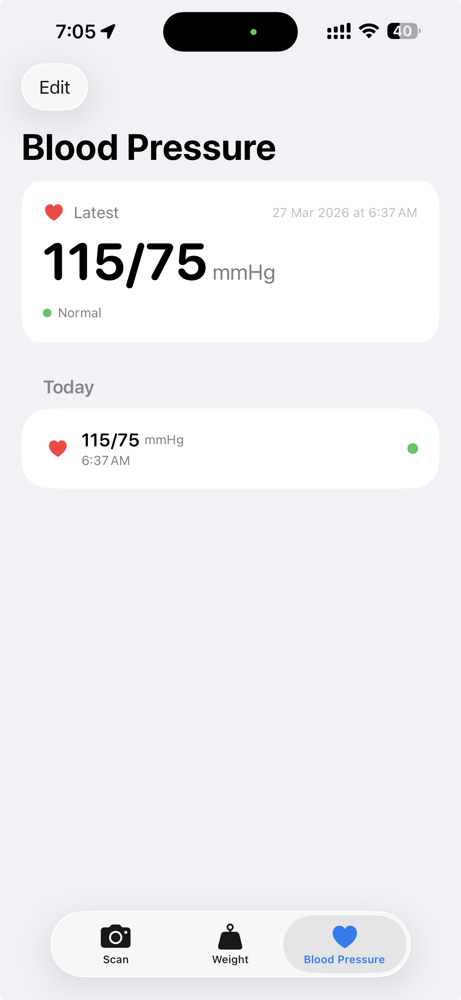
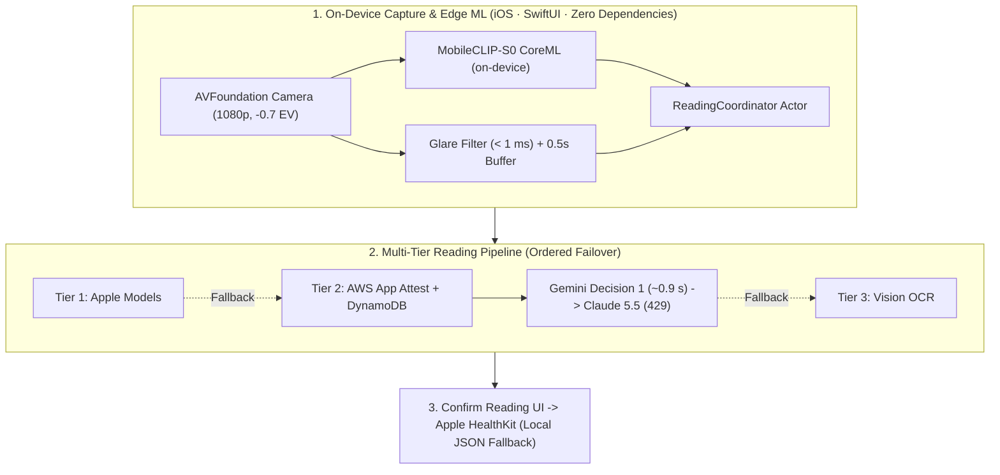

# HealthRead

**Full-stack, privacy-first iOS health logger combining real-time on-device CoreML detection, glare-aware frame selection, multi-model vision failover, and a zero-secret App-Attested AWS backend.**

Point an iPhone camera at a blood pressure monitor or bathroom weight scale to log structured readings directly into **Apple Health**, with zero API keys shipped in the app. HealthRead's own server never stores photos or readings. In Cloud Assisted mode, a photo Apple's models can't read is sent to Google Gemini (or Anthropic Claude when Gemini is busy) under their API terms; Fully On-Device mode sends nothing.

> **HealthRead is not a medical device.** Always check each number against your monitor or scale before saving.


<table>
  <tr>
    <td></td>
    <td></td>
    <td></td>
    <td></td>
  </tr>
  <tr>
    <td align="center">Live detection</td>
    <td align="center">Analyzing</td>
    <td align="center">Confirm reading</td>
    <td align="center">BP history</td>
  </tr>
</table>

---

## System Architecture



---

## Model Evaluation & Bake-Off

Seven-segment LCD displays under home lighting (glare, viewing angles, printed cuff text, clocks/dates) are notoriously difficult for standard OCR. For health logging, **a missing reading is safe; a hallucinated number is not.**

To choose the production reading pipeline objectively, I benchmarked **9 model and prompt/output formulations** on **40 real-world labeled home blood pressure monitor photos** (**108 labeled values**: systolic, diastolic, and pulse) from a public CC BY 4.0 dataset (see [Credits](#credits)). Raw per-photo results are in [`docs/bakeoff-results/all_results.csv`](docs/bakeoff-results/all_results.csv).

This is a small sample: a gap of one to three photos (38 vs. 36 vs. 35) is within noise. Readings were rebuilt from the dataset's per-digit labels and spot-checked by hand. Only blood pressure monitors were tested; weight scales were not.

| Reader / Formulation | Full Photos Right | Values Right | Wrong Values | Abstained (`empty`) | Median Latency | Role in Production |
|---|---:|---:|---:|---:|---:|---|
| **Gemini Decision 1 (`choice, numbers`)** | **38 / 40 (95.0%)** | **105 / 108** | **1** | 2 | **917 ms** | **Primary cloud reader** |
| **Claude Sonnet 5.5** | **36 / 40 (90.0%)** | **103 / 108** | **0** | 5 | 3,190 ms | **Automatic 429 fallback** |
| Gemini Decision 1 (`choice, sentences`) | 35 / 40 (87.5%) | 98 / 108 | 1 | 9 | 1,280 ms | Ablation |
| Gemini Decision 1 (`score`) | 35 / 40 (87.5%) | 103 / 108 | 3 | 2 | 891 ms | Ablation |
| Claude Opus 5.5 | 34 / 40 (85.0%) | 99 / 108 | 2 | 7 | 2,444 ms | Benchmarked |
| Cloudflare Clairic | 34 / 40 (85.0%) | 102 / 108 | 6 | 0 | 1,374 ms | Benchmarked |
| Gemini Decision 1 (`per digit`) | 27 / 40 (67.5%) | 93 / 108 | 13 | 2 | 791 ms | Ablation |
| Apple Foundation Models (on-device, Mac) | 25 / 40 (62.5%) | 83 / 108 | 23 | 2 | 10,000 ms | On-device mode |
| Claude Haiku 5.5 | 23 / 40 (57.5%) | 83 / 108 | 13 | 12 | 3,112 ms | Benchmarked |

### Key ML Findings
1. **Output formulation outperformed model scaling**: Recasting numeric extraction as calibrated multiple-choice classification over plausible ranges (`60..259` mmHg + `unreadable`) beat per-digit decoding by **+27.5 percentage points** (95.0% vs. 67.5%) and beat every generative VLM tested, at about **0.9 s per photo versus 3.2 s for Claude Sonnet** (Gemini was timed calling Google directly from a Mac, Sonnet through the Lambda, so the gap is approximate), using ~7.1k input tokens, 0 output tokens, ~$0.0007/photo.
2. **Calibrated probabilities flagged the single error**: On `Gemini: choice, numbers`, median confidence on correct values was **0.978**, whereas the single misread value scored **0.471**, so the `< 0.80` `unclear` threshold would flag it. Today that flag is recorded in anonymous analytics only; the app doesn't yet act on it.
3. **Safety-driven failover**: Claude Sonnet beat Claude Opus in both full-photo accuracy (90.0% vs. 85.0%) and safety (**0 wrong values**, choosing to abstain on ambiguous displays), making it the optimal fallback whenever Gemini is rate-limited.

---

## Engineering Highlights

### 1. Real-Time Edge ML & Glare-Resistant Capture
- **On-device MobileCLIP-S0 (CoreML)**: Classifies camera frames as they arrive (256 × 256 RGB, 256-dim embeddings) using a **pure-Swift CLIP BPE tokenizer** (77-token context) for zero-shot device detection (`≥ 0.22` cosine similarity) without network traffic.
- **Sub-millisecond glare scoring & best-frame shutter**: [`FrameQuality.swift`](HealthRead/FrameQuality.swift) samples raw YUV/BGRA `CVPixelBuffer` memory across the center 70% of each frame (`< 1 ms` at 1080p) to warn users when specular glare obscures the screen. [`RecentFrames`](HealthRead/FrameQuality.swift) retains a 0.5 s rolling window so tapping capture automatically selects the **least-glary frame** rather than the newest frame, combined with `-0.7 EV` exposure tuning and pinch-to-zoom (`videoZoomFactor`, which crops the sensor before the frame is scaled down, so zooming adds real detail).
- **Cold-start masking**: `CloudReader.prepare()` runs App Attest registration and sends a lightweight warm-up request before the shutter fires so inference latency stays predictable.

### 2. Zero-Secret Full-Stack Security & Cost Controls
- **Apple App Attest implemented from scratch**: [`appattest.py`](server/reading-service/appattest.py) implements Apple's full 9-step attestation check (X.509 certificate chain validation to Apple's Root CA, CBOR decoding, nonce extension verification, App ID and AAGUID enforcement) plus per-request ECDSA P-256 assertion verification over `SHA256(request_body)`.
- **Replay-safe state & spend caps**: [`store.py`](server/reading-service/store.py) uses DynamoDB conditional updates (`counter < new_counter`) to defeat concurrent replay attacks, single-use 5-minute challenges, and atomic per-device (`20/day`) and global (`300/day`) quotas with automatic TTL cleanup.
- **Keyless provider auth (Workload Identity Federation)**: No static Anthropic API key exists anywhere. The Lambda role requests a 5-minute regional AWS STS JWT (`sts:GetWebIdentityToken`) and exchanges it for short-lived Anthropic credentials via the Claude Console federation rule. The Gemini key is stored in AWS Secrets Manager and cached per container.
- **No photo persistence on HealthRead's server**: Uploaded JPEGs are validated (`≤ 1.5 MB`, JPEG magic bytes), processed in memory, and never written to disk or logs. They are forwarded to Google (or Anthropic on fallback), whose API data terms apply.

### 3. Resilient Multi-Tier Reader & Native iOS Craft
- **User-controlled privacy modes**: Onboarding and Settings let users pick **Cloud Assisted** (`Apple PCC → Apple On-Device → App-Attested Cloud [Gemini → Claude] → Vision OCR`) or **Fully On-Device** (`Apple On-Device → Vision OCR`).
- **Clinical guardrails**: Prompts instruct models never to guess occluded digits; the Vision OCR fallback strips clocks/dates and enforces physiological bounds (`SYS > DIA`, pulse pressure `≥ 10 mmHg`, scale unit disambiguation). Users always confirm readings next to the captured photo before saving.
- **Zero third-party iOS dependencies**: Built entirely on Apple frameworks (`SwiftUI`, `AVFoundation`, `CoreML`, `HealthKit`, `DeviceCheck`, `CryptoKit`, `Vision`, `FoundationModels`), structured Swift concurrency (`actor`, `AsyncStream`), and zero-SDK PostHog telemetry ([`Analytics.swift`](HealthRead/Analytics.swift)) that excludes health values, photos, and debug/test traffic.

---

## Tech Stack

| Layer | Technologies |
|---|---|
| **iOS App** | Swift 5.9, SwiftUI, `@Observable`, Swift Concurrency (`actor`, `AsyncStream`), zero SPM dependencies |
| **Camera & CV** | `AVFoundation` (1080p, `-0.7 EV`, pinch zoom), raw `CVPixelBuffer` glare analysis, `Vision` (`VNRecognizeTextRequest`) |
| **On-Device ML** | CoreML (`MobileCLIP-S0` on Apple Neural Engine), pure-Swift GPT-2 BPE tokenizer, Apple `FoundationModels` (`@Generable`) |
| **Cloud AI** | Google Gemini Decision 1 (Decisions API, calibrated multi-choice), Anthropic Claude Sonnet 5.5 (structured JSON schema fallback) |
| **Backend & IaC** | AWS SAM, AWS Lambda (`python3.13`, `arm64`, Function URL), DynamoDB (PAY_PER_REQUEST + TTL), Secrets Manager, STS Workload Identity Federation |
| **Security & Health** | Apple App Attest (`DCAppAttestService`, X.509/CBOR/ECDSA verification), `HealthKit` (`HKCorrelation`, `HKQuantitySample`) + local `Codable` fallback |
| **Testing & Telemetry** | Simulated-CA cryptographic test suite (`test_appattest.py`), zero-SDK anonymous PostHog events |

---

## Key Files

| File | Responsibility |
|---|---|
| [`HealthRead/ReadingEngines.swift`](HealthRead/ReadingEngines.swift) | `ReadingCoordinator` failover chain, `AppAttestClient`, Apple `FoundationModels` reader, and Vision OCR heuristics |
| [`HealthRead/FrameQuality.swift`](HealthRead/FrameQuality.swift) | Sub-millisecond pixel-buffer glare scorer and 0.5 s `RecentFrames` best-frame selector |
| [`HealthRead/ZSImageClassification.swift`](HealthRead/ZSImageClassification.swift) | CoreML `MobileCLIP-S0` actor and cosine-similarity inference |
| [`HealthRead/Tokenizer/CLIPTokenizer.swift`](HealthRead/Tokenizer/CLIPTokenizer.swift) | Pure-Swift GPT-2 BPE tokenizer |
| [`HealthRead/HealthKitManager.swift`](HealthRead/HealthKitManager.swift) | HealthKit correlation/quantity persistence with local JSON fallback |
| [`server/reading-service/app.py`](server/reading-service/app.py) | Lambda HTTP router (`/challenge`, `/attest`, `/read`), STS WIF Anthropic client, and Gemini → Claude failover |
| [`server/reading-service/gemini.py`](server/reading-service/gemini.py) | Gemini Decision 1 multi-choice schema, confidence calibration, and weight decomposition |
| [`server/reading-service/appattest.py`](server/reading-service/appattest.py) | Apple App Attest X.509 certificate chain and ECDSA assertion verifier |
| [`server/reading-service/store.py`](server/reading-service/store.py) | DynamoDB atomic replay protection, one-time challenges, and daily usage caps |
| [`server/reading-service/template.yaml`](server/reading-service/template.yaml) | AWS SAM infrastructure definition (Lambda, IAM least-privilege policies, DynamoDB, CloudWatch Logs) |
| [`server/reading-service/test_appattest.py`](server/reading-service/test_appattest.py) | End-to-end attestation/assertion unit tests using a simulated Apple CA and Secure Enclave key |

---

## Getting Started

### 1. Run the iOS App
**Requirements:** Xcode 27.2+ (the iOS 27 SDK, for the `FoundationModels` APIs) and a physical iPhone on iOS 17.2+ (camera, HealthKit, and App Attest need real hardware).

1. Clone the repository and open `HealthRead.xcodeproj`.
2. Download `mobileclip_s0_text.mlpackage` from [Hugging Face](https://huggingface.co/apple/coreml-mobileclip/tree/main) into `HealthRead/Models/`. The image encoder (`mobileclip_s0_image.mlpackage`) is already in the repo.
3. Select your Apple Development Team in Signing & Capabilities.
4. *(Optional)* Create `HealthRead/Configuration/Local.xcconfig` with `POSTHOG_API_KEY = phc_...` to enable anonymous usage analytics.
5. Build and run on a physical iPhone.

Manual entry and the on-device readers work in any build. **Cloud reading only works against a reading service that trusts your build:** the hosted service accepts App Attest keys from this repo's own signed app ID only, so a build signed with your team will be rejected. To use cloud reading from your own build, deploy the service below with your app ID and point `CloudReader.serviceURL` in [`ReadingEngines.swift`](HealthRead/ReadingEngines.swift) at it.

### 2. Deploy the Serverless Reading Service
**Requirements:** AWS CLI, [AWS SAM CLI](https://docs.aws.amazon.com/serverless-application-model/latest/developerguide/install-sam-cli.html), Python 3.13.

1. Store your Gemini API key in AWS Secrets Manager as a plain string (default secret name: `healthread/gemini-api-key`). Use a Gemini project with billing enabled before real users send photos: Google may use free-tier inputs to improve its products.
2. Build and deploy the SAM stack:
   ```bash
   cd server/reading-service
   sam build
   sam deploy --guided
   ```
   When prompted, set `AppId` to `<your Team ID>.<your bundle ID>` (App Attest only trusts that app). For the Claude fallback, also set `AnthropicOrganizationId` and `AnthropicFederationRuleId` (plus `AnthropicWorkspaceId` if the rule covers several workspaces). Leave `DevBypassToken` empty in production.
3. Create the Claude Console Workload Identity Federation rule to match the stack's `RoleArn` output, and set `CloudReader.serviceURL` in [`ReadingEngines.swift`](HealthRead/ReadingEngines.swift) to the `ServiceURL` output.

### 3. Run Backend Security Tests
```bash
cd server/reading-service
pip install -r requirements.txt
python3 test_appattest.py
```

---

## Credits

- **MobileCLIP** model weights, CoreML exports, and reference tokenizer/camera scaffolding by [Apple Research](https://github.com/apple/ml-mobileclip).
- **Bake-off photos and digit labels**: "BP Monitor Reading | Medical Device Images" by DataCluster Labs, via [Roboflow Universe](https://universe.roboflow.com/datacluster-labs-agryi/bp-monitor-reading-medical-device-images), licensed [CC BY 4.0](https://creativecommons.org/licenses/by/4.0/). The published CSV lists each photo's source file; readings were rebuilt from the per-digit labels, one label was corrected, and two photos were excluded.
